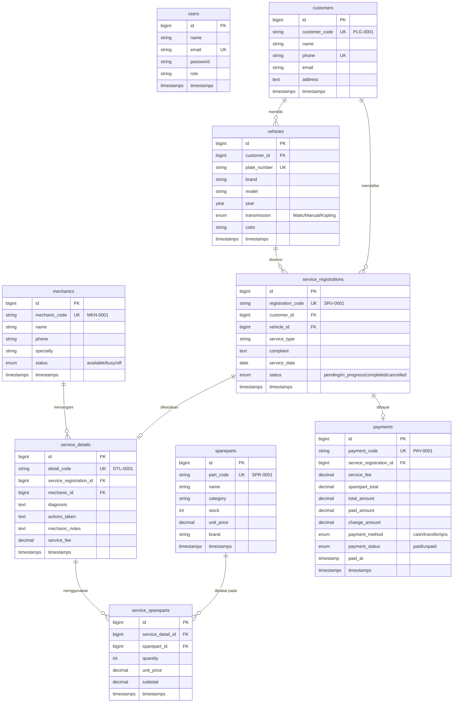

# MOTOVEL — Precision Motorcycle Service Management System

<p align="center">
  
  
  
  
  
  
</p>

> **"Beyond Ordinary. Built on Precision. Precision Care. Performance You Can Trust."**

MOTOVEL adalah sistem informasi manajemen servis sepeda motor modern berbasis web berskala enterprise yang dirancang untuk mengintegrasikan seluruh alur operasional perbengkelan motor kelas premium, mulai dari portal reservasi publik daring hingga sistem pengelolaan kasir dan pelaporan manajerial terpusat.

---

## 📑 Daftar Isi
- [Fitur Utama](#-fitur-utama)
- [Arsitektur Sistem & Basis Data](#-arsitektur-sistem--basis-data)
- [Teknologi yang Digunakan](#-teknologi-yang-digunakan)
- [Panduan Instalasi & Menjalankan Proyek](#-panduan-instalasi--menjalankan-proyek)
- [Akun Demo Pengguna](#-akun-demo-pengguna)
- [Dokumentasi REST API v1](#-dokumentasi-rest-api-v1)
- [Pengujian Menggunakan Postman](#-pengujian-menggunakan-postman)
- [Dokumentasi Laporan Praktikum](#-dokumentasi-laporan-praktikum)
- [Lisensi](#-lisensi)

---

## 🚀 Fitur Utama

### 1. Public Website & Booking Engine
- **Dark Luxury Automotive Editorial UI:** Desain antarmuka mewah dengan palet gelap presisi (`#08090B`, `#111216`, `#191A1F`), aksen merah balap (`#C62828`), dan tipografi *Cormorant Garamond* & *Inter*.
- **Landing Page Interaktif:** Hero section dinamis, pengenalan filosofi presisi, grid paket servis (General, Overhaul, Fluid, Brake, Tire, Diagnostic), alur kerja servis transparan, testimoni, FAQ interaktif, dan footer informatif.
- **Multi-Step Booking Wizard:** Reservasi jadwal servis mandiri oleh pemilik motor dengan verifikasi nomor telepon asinkron via AJAX (`/booking/check-phone`). Jika nomor telepon telah terdaftar, identitas pelanggan dan daftar armada motor otomatis terisi (*auto-fill*).
- **Halaman Sukses Booking:** Menerbitkan e-tiket resmi pendaftaran servis dengan kode reservasi unik (`SRV-xxxx`).

### 2. Admin Dashboard & Backoffice (Terproteksi Autentikasi)
- **Ringkasan KPI Real-Time:** Kartu metrik total pelanggan aktif, unit motor terdaftar, antrean servis aktif, dan akumulasi omzet pendapatan bersih.
- **Manajemen Master Data (CRUD Lengkap):**
  - **Pelanggan (`customers`):** Pengelolaan data identitas pelanggan dengan kode otomatis `PLG-xxxx`.
  - **Armada Motor (`vehicles`):** Pencatatan nomor plat unik, merk, model, tipe transmisi (Matic, Manual, Kopling), tahun pembuatan, dan relasi kepemilikan.
  - **Mekanik (`mechanics`):** Direktori montir bersertifikat dengan kode `MKN-xxxx`, spesialisasi kerja, serta indikator status operasional (*Available*, *Busy*, *Off*).
- **Alur Pengerjaan Servis Teknis:**
  - **Pendaftaran Servis (`services`):** Penerimaan motor langsung di bengkel (*walk-in*), penugasan mekanik, dan pelacakan status (*Pending*, *In Progress*, *Completed*, *Cancelled*).
  - **Lembar Kerja Montir (`service-details`):** Diagnosa kerusakan teknis, tindakan perbaikan, catatan mekanik, penetapan biaya jasa servis, serta alokasi penggunaan suku cadang.
- **Inventaris & Pengurangan Otomatis Suku Cadang (`spareparts`):**
  - Katalog suku cadang dengan kode `SPR-xxxx`, kategori barang, harga satuan, dan kuantitas stok.
  - Pengurangan kuantitas stok secara otomatis (*auto-decrement*) saat suku cadang dimasukkan ke lembar kerja servis.
  - Peringatan stok kritis (*low stock badge*).
- **Kasir Pembayaran & Cetak Struk (`payments`):**
  - Akumulasi otomatis biaya jasa perbaikan dan belanja sparepart.
  - Pilihan metode bayar: Tunai (*Cash*), Transfer Bank, dan QRIS.
  - Kalkulasi uang kembalian secara reaktif berbasis JavaScript.
  - **Thermal Receipt Layout:** Cetak nota struk kasir resmi berstandar printer termal melalui dialog cetak browser (`window.print()`).
- **Penelusuran Riwayat & Laporan Keuangan:**
  - **Riwayat Servis (`history`):** Lacak riwayat kendaraan dari sejak pendaftaran awal hingga pembayaran selesai lunas.
  - **Laporan Periode (`reports`):** Filter tanggal kustom, rangkuman omzet, dan cetak laporan manajerial siap cetak (*print-optimized*).

---

## 🗄️ Arsitektur Sistem & Basis Data

Sistem MOTOVEL dirancang menggunakan arsitektur **Model-View-Controller (MVC)** dengan basis data relasional **MySQL / MariaDB** (`motovel_db`).



---

## 🛠️ Teknologi yang Digunakan

| Komponen | Spesifikasi / Alat |
|---|---|
| **Framework Backend** | Laravel 12.x |
| **Bahasa Pemrograman** | PHP 8.2+ |
| **Basis Data** | MySQL / MariaDB (XAMPP 8.2+) |
| **Object-Relational Mapping (ORM)** | Laravel Eloquent ORM |
| **Frontend Templating** | Laravel Blade Engine |
| **CSS Framework** | Tailwind CSS v4.0 |
| **JavaScript Utility** | Alpine.js 3.x |
| **Asset Bundler** | Vite 6.x |
| **API Testing** | Postman Desktop Agent (Collection v2.1.0) |
| **Version Control** | Git 2.40+ & GitHub |

---

## 💻 Panduan Instalasi & Menjalankan Proyek

### 1. Kloning Repositori
```bash
git clone https://github.com/<username>/motovel.git
cd motovel
```

### 2. Pasang Dependensi PHP & JavaScript
```bash
composer install
npm install
```

### 3. Konfigurasi Lingkungan (`.env`)
Salin berkas template lingkungan dan generate encryption key:
```bash
copy .env.example .env
php artisan key:generate
```

Pastikan konfigurasi basis data pada berkas `.env` telah disesuaikan:
```env
DB_CONNECTION=mysql
DB_HOST=127.0.0.1
DB_PORT=3306
DB_DATABASE=motovel_db
DB_USERNAME=root
DB_PASSWORD=
```

### 4. Eksekusi Migrasi & Seeding Data Awal
Buat database `motovel_db` terlebih dahulu di MySQL/phpMyAdmin, lalu jalankan:
```bash
php artisan migrate:fresh --seed
```

### 5. Kompilasi Aset Frontend
```bash
npm run build
```
*(Atau gunakan `npm run dev` untuk pengembangan aktif dengan Hot Module Replacement).*

### 6. Jalankan Server Lokal
```bash
php artisan serve
```
Akses aplikasi melalui peramban: **`http://127.0.0.1:8000`**

---

## 🔑 Akun Demo Pengguna

Data kredensial bawaan hasil eksekusi seeder untuk masuk ke Admin Dashboard:

| Role | Email Login | Password | Hak Akses |
|---|---|---|---|
| **Administrator** | `admin@motovel.test` | `password` | Akses penuh (Dashboard, CRUD master data, kasir, laporan, histori) |

URL Halaman Login: **`http://127.0.0.1:8000/login`**

---

## 🔌 Dokumentasi REST API v1

MOTOVEL menyediakan **35 endpoint RESTful API terstandarisasi** di bawah prefiks `/api/v1/`.

| Modul Sumber Daya | Endpoint URI | Metode HTTP | Deskripsi Fungsional |
|---|---|---|---|
| **Customers** | `/api/v1/customers` | `GET`, `POST` | Ambil semua pelanggan / Tambah pelanggan baru |
| | `/api/v1/customers/{id}` | `GET`, `PUT`, `DELETE` | Ambil detail / Perbarui / Hapus pelanggan |
| **Vehicles** | `/api/v1/vehicles` | `GET`, `POST` | Ambil semua motor / Daftarkan motor baru |
| | `/api/v1/vehicles/{id}` | `GET`, `PUT`, `DELETE` | Ambil detail / Perbarui / Hapus motor |
| **Mechanics** | `/api/v1/mechanics` | `GET`, `POST` | Ambil semua mekanik / Tambah mekanik baru |
| | `/api/v1/mechanics/{id}` | `GET`, `PUT`, `DELETE` | Ambil detail / Perbarui / Hapus mekanik |
| **Services** | `/api/v1/services` | `GET`, `POST` | Ambil semua tiket servis / Buat pendaftaran baru |
| | `/api/v1/services/{id}` | `GET`, `PUT`, `DELETE` | Ambil detail / Ubah status / Hapus tiket servis |
| **Service Details** | `/api/v1/service-details` | `GET`, `POST` | Ambil data pengerjaan / Input pengerjaan teknis montir |
| | `/api/v1/service-details/{id}` | `GET`, `PUT`, `DELETE` | Ambil detail / Perbarui diagnosa / Hapus lembar kerja |
| **Spareparts** | `/api/v1/spareparts` | `GET`, `POST` | Ambil katalog sparepart / Tambah stok sparepart baru |
| | `/api/v1/spareparts/{id}` | `GET`, `PUT`, `DELETE` | Ambil detail / Update stok & harga / Hapus sparepart |
| **Payments** | `/api/v1/payments` | `GET`, `POST` | Ambil semua transaksi / Input pembayaran kasir |
| | `/api/v1/payments/{id}` | `GET`, `PUT`, `DELETE` | Ambil detail nota / Perbarui status / Hapus transaksi |

### Format Standar Respon JSON
- **Respon Berhasil (HTTP 200 / 201):**
```json
{
  "success": true,
  "message": "Data pelanggan berhasil diambil.",
  "data": [ ... ]
}
```
- **Respon Gagal / Validasi (HTTP 422):**
```json
{
  "success": false,
  "message": "Validasi gagal.",
  "errors": {
    "name": ["Nama pelanggan wajib diisi."]
  }
}
```

---

## 📮 Pengujian Menggunakan Postman

Berkas koleksi pengujian resmi telah disertakan di dalam repositori:  
📂 **`postman/MOTOVEL_API_Collection.json`**

### Cara Menggunakan Koleksi Postman:
1. Buka aplikasi **Postman**.
2. Klik tombol **Import** di sudut kiri atas.
3. Pilih berkas `postman/MOTOVEL_API_Collection.json`.
4. Koleksi **"MOTOVEL API v1"** akan terimpor secara otomatis dengan 7 folder sumber daya dan **35 request endpoint siap uji**.
5. Pastikan variabel lingkungan `base_url` bernilai `http://127.0.0.1:8000`.
6. Klik **Run Collection** untuk mengeksekusi seluruh pengujian secara otomatis (**Hasil: 35 Passed, 0 Failed**).

---

## 📚 Dokumentasi Laporan Praktikum

Laporan lengkap praktikum berbasis standar akademik perguruan tinggi telah disusun secara terperinci di direktori `docs/`:
- 📕 **[docs/LAPORAN_PRAKTIKUM_MOTOVEL.pdf](docs/LAPORAN_PRAKTIKUM_MOTOVEL.pdf)**: Dokumen resmi siap cetak (92 halaman) lengkap dengan Halaman Judul Formal (Politeknik Negeri Lhokseumawe, TRKJ.2A), BAB I Pendahuluan, BAB II Percobaan (Alat, Bahan, dan Prosedur Kerja), BAB III Penutup & Kesimpulan, serta Lampiran Kode Sumber dengan 62 tangkapan layar beresolusi tinggi.
- 🌐 **[docs/LAPORAN_PRAKTIKUM_MOTOVEL.html](docs/LAPORAN_PRAKTIKUM_MOTOVEL.html)**: Naskah laporan versi *standalone HTML* (3.28 MB) dengan gambar tertanam (*base64 self-contained*) yang dapat dibuka langsung pada peramban web tanpa memerlukan dependensi eksternal.
- 📝 **[docs/LAPORAN_PRAKTIKUM_MOTOVEL.md](docs/LAPORAN_PRAKTIKUM_MOTOVEL.md)**: Naskah format Markdown naskah lengkap (BAB I, II, III, dan Lampiran).
- 📋 **[docs/LAPORAN_LANGKAH_KERJA_MOTOVEL.md](docs/LAPORAN_LANGKAH_KERJA_MOTOVEL.md)**: Naskah langkah kerja prosedural format Bab 5, 6, 7 acuan praktikum dengan 62 gambar tangkapan layar.
- 🖼️ **[docs/screenshots/](docs/screenshots/)**: Direktori berisi 62 berkas tangkapan layar resolusi tinggi yang mencakup eksekusi CLI, skema basis data, antarmuka web, pengujian Postman, repositori GitHub, dan kode sumber sistem.

---

## 📄 Lisensi

Proyek ini dikembangkan di bawah lisensi terbuka [MIT License](LICENSE).
Semua kode program bebas dipelajari, dikembangkan, dan dimodifikasi untuk keperluan akademik maupun komersial.
